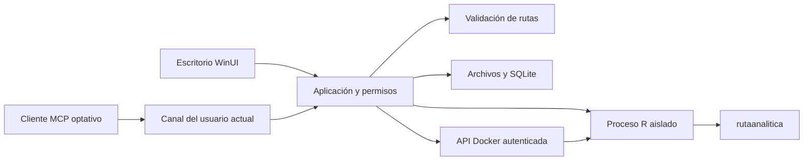

# Arquitectura

El escritorio WinUI usa controles nativos y `ModeloVista` para mensajes observables. `VentanaPrincipal` coordina navegación y adaptadores; aún concentra lógica de interacción que debe separarse en modelos de vista por pantalla. Dominio no depende de WinUI. Contratos es la capa inferior.

`RepositorioProyectos` posee el índice SQLite y instantáneas. El contenedor recibe CSV y contrato; no abre la base de escritorio ni recibe rutas del host. `MotorRLocal` usa argumentos separados, entorno reducido y proceso nuevo por solicitud. La cola estática limita a un proceso local por aplicación. El proceso separado no es una caja de aislamiento frente a código arbitrario: tal capacidad no se ofrece.

`CoordinadorAnalisis` invalida resultados obsoletos; el escritorio además compara revisión e identidad del proyecto. El intermediario verifica permiso antes de atender cada herramienta y antes de devolver contenido. El límite real de confianza son los procesos del usuario actual, no malware de ese mismo usuario.

Solo `rutaanalitica::analizar` calcula estadísticas. El código .NET analiza formatos, normaliza valores y coordina persistencia. Los gráficos son PNG de R, no dependen de un navegador.

Configuración: recursos inmutables junto al ejecutable, datos en perfil de usuario, secreto Docker fuera del repositorio. Fallos se expresan mediante códigos españoles. Reproduzca el flujo con [recorrido](recorrido_completo.md); pruebas en [calidad](pruebas_y_calidad.md). No se han medido aún límites de memoria por proceso Windows.
