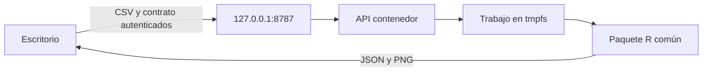

# Motor Docker

Implementación en [Dockerfile](../contenedores/Dockerfile), [Compose](../contenedores/compose.yaml), `MotorDocker` y `ServidorLocal/Program.cs`. El escritorio permanece nativo. La API usa el mismo paquete R. El contenedor no monta la base ni carpetas del usuario.

## Preparación y ciclo de vida

Instale Docker Desktop por separado según [documentación oficial](https://docs.docker.com/desktop/setup/install/windows-install/). Requiere virtualización y un backend compatible, por ejemplo WSL 2. Revise los términos aplicables a su organización: no se afirma que sea gratuito para todas. No se redistribuye Docker Desktop.

```powershell
./guiones/iniciar_contenedores.ps1 -Construir
docker compose -f contenedores/compose.yaml ps
./guiones/detener_contenedores.ps1
docker image save ruta-estadistica-motor:0.1.0 -o motor-local.tar
docker image load -i motor-local.tar
```

Los comandos Compose manuales requieren `RUTA_ESTADISTICA_ARCHIVO_SECRETO` apuntando al archivo creado por el guion en el perfil de usuario. `docker image save/load` permite trasladar una imagen ya preparada sin conexión. Verifique su hash antes de cargarla.

El guion genera 48 bytes aleatorios y restringe ACL del archivo. No imprima ni versione su contenido. Compose monta el archivo como secreto. Docker puede acceder a él según permisos del host; esto no es un almacén de secretos frente al administrador del equipo.

La publicación es `127.0.0.1:8787`. El servicio escucha dentro del contenedor y exige Bearer, rechaza Origin y Host diferente de localhost/127.0.0.1. No habilita CORS. Sistema raíz solo lectura, usuario 1654, sin capacidades, sin privilegios nuevos, tmpfs 256 MiB, 1 GiB/2 CPU/64 procesos. No hay socket del daemon ni montaje de unidad.



## Diagnóstico y límites

Si falta Docker/imagen o no hay salud compatible, seleccione Local. Compruebe `docker info`, estado del servicio y puerto; los guiones solo actúan sobre el servicio `motor` del proyecto `ruta-estadistica`. No ejecute limpiezas globales. Los logs HTTP se desactivan para evitar credenciales/valores accidentales.

La compilación de imagen y la paridad Windows/Linux **no están verificadas** en esta máquina sin Docker. Las imágenes base tienen versiones, pero aún faltan digests verificados, fijación de paquetes apt y revisión de bibliotecas Linux. Esta definición no es una imagen de producción. Antes de actualizar, guarde la imagen anterior, verifique contrato y paridad; vuelva a cargar la versión anterior si falla. Véanse [depuración](depuracion.md) y [estado](estado_entrega.md).
