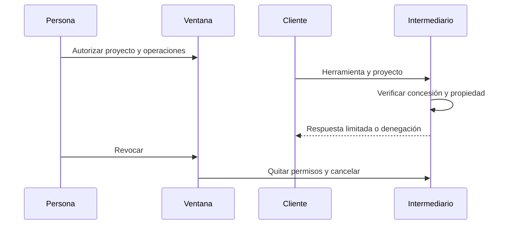

# Integración MCP optativa

El ejecutable separado utiliza `ModelContextProtocol` 2.3.0, SDK oficial. El transporte externo es stdio; logs solamente en stderr. La especificación latest consultada el 27/10/2026 corresponde a 2026-07-28. No se mezcla su negociación por solicitud con un cliente de inicialización antiguo. La revisión efectivamente negociada debe registrarse mediante la prueba stdio antes de declarar compatibilidad.

No hay proveedor de modelos, clave API ni transporte HTTP MCP. Un cliente conectado puede transmitir contenido a un servicio externo; el consentimiento de la UI lo explica. El análisis local no utiliza ese cliente.

1. Abra la aplicación y el proyecto.
2. En Configuración revise permisos de cálculo y exportación por separado; pulse Autorizar MCP y confirme el diálogo.
3. Inicie el ejecutable `integracion/RutaEstadistica.ServidorMcp.exe` de la distribución local. Tras instalar un paquete con alias validado, la configuración prevista es `{"mcpServers":{"ruta":{"command":"ruta-estadistica-mcp.exe","args":[]}}}`. La clave `mcpServers` depende del cliente y no es dominio propio.
4. Revoque desde Configuración. Al cerrar, las concesiones caducan. La aplicación no arranca oculta si falta el intermediario.

El canal `RutaEstadistica_<hash_usuario>` usa `CurrentUserOnly`, una solicitud por conexión y 64 KiB. No es una barrera frente a malware del mismo usuario. Las concesiones actuales son de sesión, no persistidas; se prefiere volver a pedir consentimiento hasta completar almacenamiento y revocación robusta.

Las nueve herramientas son `listar_proyectos_autorizados`, `obtener_esquema_datos`, `obtener_resumen_datos`, `proponer_ruta_analisis`, `ejecutar_analisis`, `consultar_trabajo`, `cancelar_trabajo`, `obtener_resultado`, `exportar_informe`. Las herramientas no reciben archivos ni código. Proyecto y trabajo se comprueban antes de devolver información. Las filas originales, residuos y ajustados no se exponen. El resumen es actualmente de recuentos, no todas las estadísticas descriptivas. La propuesta de ruta es básica descriptiva. Recursos de catálogo y esquema de salida específico por herramienta están pendientes.

Sin permiso: `MCP_PERMISO_DENEGADO`. Deshabilitado: `MCP_DESHABILITADO`. Aplicación cerrada: `MCP_APLICACION_NO_DISPONIBLE`. No se confía en una afirmación del modelo de que ya existe consentimiento.

No se declara probado ningún cliente externo ni el alias en una cuenta limpia. La prueba de negociación y las pruebas de aislamiento/revocación aparecen en [calidad](pruebas_y_calidad.md); inspeccione [estado](estado_entrega.md). El broker tiene límite de dos trabajos activos y cien trabajos por sesión. La cancelación no devuelve datos tras una revocación.
