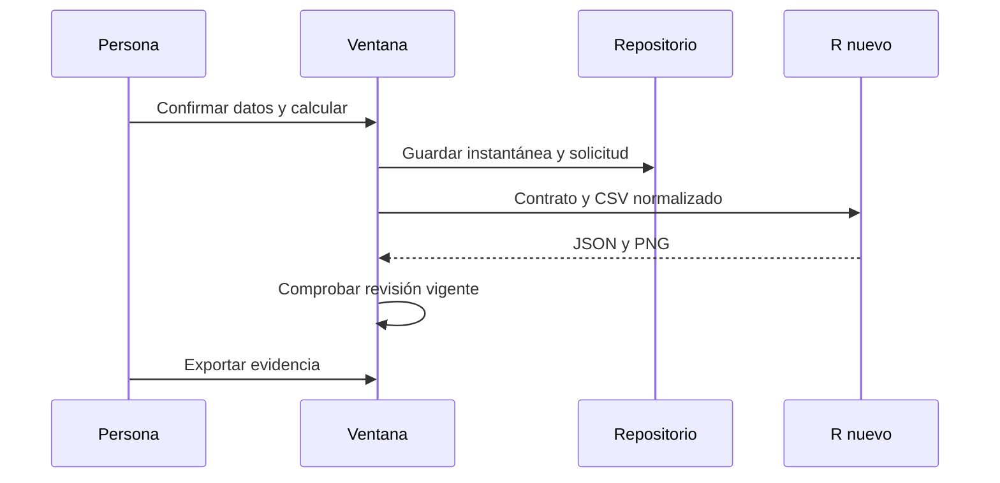

# Recorrido reproducible

1. Prepare recursos y publique según [instalación](instalacion_desarrollo.md).
2. Abra el ejecutable, pulse Probar ejemplo y Calcular. Se crea una identidad aleatoria de proyecto. La columna `c001` contiene 10, 12, 14, 17, 19 y 21. Su media de referencia es 15,5.
3. `ProbarEjemplo` importa sin conversión implícita y confirma roles. `GuardarDatos` conserva el original con SHA-256; el índice SQLite contiene pregunta y contexto.
4. `Calcular` crea un `SolicitudAnalisis` con identidad aleatoria, hashes del CSV normalizado y política explícita. `CoordinadorAnalisis.EjecutarAsync` valida y solicita el motor.
5. `MotorRLocal.CalcularAsync` escribe `entrada.csv` y `solicitud.json` en `trabajo_<id>`, inicia R con `--vanilla` y espera como máximo 60 s.
6. `trabajador.R` llama a `rutaanalitica::analizar`; los valores no se generan en la interfaz. El JSON relaciona `solicitud_id` con hashes, recuentos y versión 4.5.2. Abra los archivos para obtener los identificadores reales de esa ejecución; no se inventa un identificador de una ejecución no realizada.
7. Exporte desde Evidencia. Abra `informe.html` sin conexión. Desde esa carpeta ejecute `Rscript --vanilla reproducir.R` con el paquete instalado y compare `cifras`, excluyendo fecha y duración.
8. Cierre y abra el proyecto. Los datos permanecen; el historial enumera trabajos guardados. La selección interactiva de un resultado histórico aún no está implementada.

Fallo controlado: importe [ejemplo colombiano](../pruebas/datos/ejemplo_colombiano.csv), asigne `numerica` a Medición COP y seleccione decimal punto. Debe recibir `DATOS_NUMERO_INVALIDO`, sin reemplazar el original. Corrija a coma y repita. Ponga un punto de interrupción en `ConfirmarRoles`.

Las comprobaciones automáticas de este flujo están en [Program.cs](../pruebas/RutaEstadistica.PruebasUnitarias/Program.cs). La ejecución desde una máquina limpia y el recorrido gráfico completo se registran por separado en [estado](estado_entrega.md).
